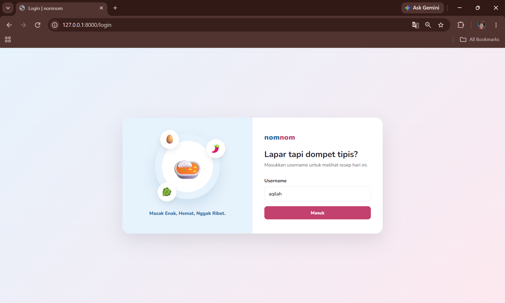
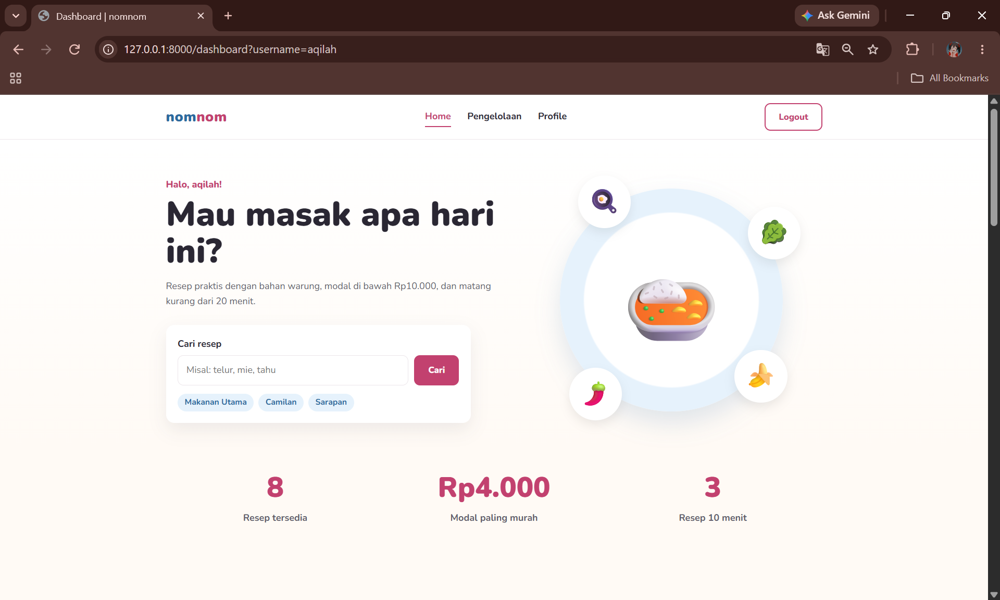
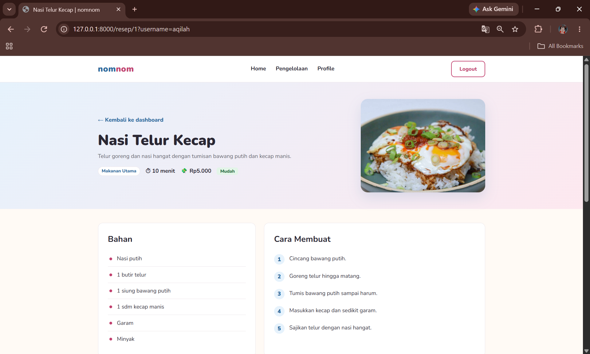
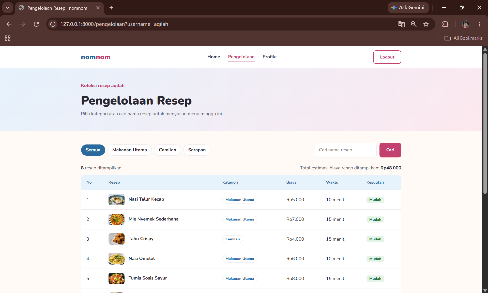
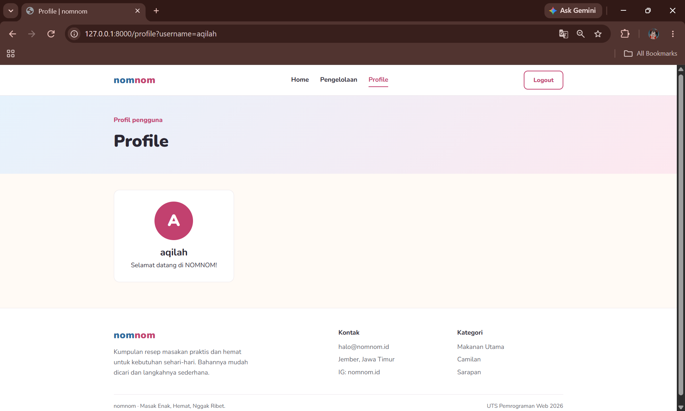

# NOMNOM – Resep Masakan Anak Kos

**Masak Enak, Hemat, Nggak Ribet.**

NOMNOM adalah website kumpulan resep praktis untuk mahasiswa dan anak kos. Setiap resep menampilkan kategori, estimasi biaya, waktu memasak, dan tingkat kesulitan. Proyek ini dibuat untuk UTS Pemrograman Web 2026 menggunakan Laravel murni (MVC + Blade), tanpa database.

- Nama: Aqilah Shabrina Suryanti
- NIM: 252410102022
- Program Studi Teknologi Informasi, Fakultas Ilmu Komputer, Universitas Jember

## Screenshot

### Login


### Dashboard


### Detail
 

### Pengelolaan


### Profile


## Fitur

- Login sederhana dengan username (dikirim lewat Request Parameter GET), lengkap dengan pesan error jika kosong
- Dashboard: sapaan username, pencarian, statistik resep, 8 resep populer, dan tips dapur
- Detail resep (`/resep/{id}`): bahan, cara membuat, estimasi biaya, dan resep lainnya
- Pengelolaan: tabel koleksi resep dengan filter kategori, pencarian nama, dan total modal
- Profile: menampilkan avatar inisial dan nama pengguna dari username login
- Tampilan responsif (desktop, tablet, HP)

## Struktur Blade

| Sintaks | Dipakai di |
|---|---|
| `@extends`, `@section`, `@yield` | Semua view memakai `layouts/app.blade.php` |
| `@include` | `partials/recipe-tip.blade.php` di Dashboard |
| `<x-navbar>`, `<x-footer>` | Layout utama |
| `<x-recipe-card>` | Dashboard dan Detail |
| `@foreach`, `@forelse` | Daftar resep, kategori, bahan, langkah, tips |

## Cara Menjalankan

```bash
php artisan serve
```
Lalu buka `http://127.0.0.1:8000`.
